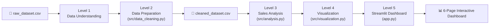

# 🛒 BigMart Retail Sales Analytics Dashboard

### Business Analytics Internship Project — Sysslan IT Solutions


**🔗 Live demo:** https://retail-sales-analytics-dashboard-zjtr7dimck2e8v2frrxujc.streamlit.app/

---

## Table of Contents

1. [Abstract](#-abstract)
2. [Problem Statement](#-problem-statement)
3. [Live Demo & Screenshots](#-live-demo--screenshots)
4. [Project Structure](#%EF%B8%8F-project-structure)
5. [Dataset Description](#-dataset-description)
6. [Data & Methodology — Read This](#-data--methodology--read-this)
7. [Architecture](#-architecture)
8. [Quick Start](#-quick-start)
9. [Running with Docker](#-running-with-docker)
10. [Deploying It Yourself](#-deploying-it-yourself)
11. [Testing & CI](#-testing--ci)
12. [Internship Levels Completed](#%EF%B8%8F-internship-levels-completed)
13. [Key Findings](#-key-findings)
14. [Tech Stack](#%EF%B8%8F-tech-stack)
15. [Skills Demonstrated](#-skills-demonstrated)
16. [Roadmap / Future Work](#-roadmap--future-work)
17. [Contributing](#-contributing)
18. [License](#-license)
19. [Contact](#-contact)

---

## 📌 Abstract

This project delivers a **production-style Business Analytics Dashboard** for
BigMart retail sales data. It covers the full data analytics lifecycle — raw
data ingestion and quality assessment, cleaning, statistical analysis,
interactive visualization, and actionable business-insight generation — built
with **Streamlit + Plotly**, backed by a **pytest** test suite, and wired into
a **GitHub Actions CI** pipeline. The work is structured across five
internship "levels," each with its own module and report.

> **New to this repo?** Start with [Data & Methodology](#-data--methodology--read-this)
> before looking at any numbers — it explains an important, deliberately
> disclosed assumption about the sales figures.

---

## 🎯 Problem Statement

BigMart operates across multiple outlet types, city tiers, and product
categories. Leadership lacks a unified view of:

- Which product categories drive the most revenue
- Which outlet types and locations are underperforming
- How pricing (MRP) correlates with sales
- Where operational improvements can unlock growth

This dashboard addresses each question through data-driven storytelling,
backed by a tested, reproducible analytics pipeline rather than one-off
spreadsheet analysis.

---

## 📸 Live Demo & Screenshots

- **Live app:** add your deployed Streamlit Cloud / Render / Railway URL here.
- **Screenshots:** drop PNGs into `assets/screenshots/` (e.g.
  `executive_summary.png`, `outlet_performance.png`) and reference them here:

  ```markdown
  
  ```

  Screenshots make this README scannable on GitHub and dramatically improve
  first impressions on a portfolio site — don't skip this step before sharing
  the link.

---

## 🏗️ Project Structure

```
Retail_Sales_Dashboard/
│
├── app.py                          ← Main Streamlit dashboard (Level 5)
├── requirements.txt                ← Runtime dependencies
├── requirements-dev.txt            ← Test/lint dependencies
├── Dockerfile                      ← Container build for deployment
├── .flake8                         ← Lint configuration
├── .gitignore
├── LICENSE
├── README.md                       ← This file
├── RESUME.md                       ← Resume bullets & portfolio copy
│
├── .github/workflows/ci.yml        ← Lint + test on every push (GitHub Actions)
│
├── data/
│   ├── raw_dataset.csv             ← Original Big Mart Sales dataset
│   └── cleaned_dataset.csv         ← Cleaned & enriched dataset (auto-generated)
│
├── src/
│   ├── __init__.py
│   ├── data_cleaning.py            ← Level 1 & 2: Understanding + Preparation
│   ├── analysis.py                 ← Level 3: Sales Analysis
│   ├── visualization.py            ← Level 4: Data Visualization (Plotly)
│   └── dashboard_utils.py          ← Level 5: Dashboard helpers & UI components
│
├── tests/                          ← pytest unit tests (30 tests)
│   ├── conftest.py
│   ├── test_data_cleaning.py
│   └── test_analysis.py
│
├── reports/
│   ├── Data_Understanding_Report.md
│   ├── Analysis_Report.md
│   └── Business_Insights_Report.md
│
├── notebooks/
│   └── analysis.ipynb              ← Jupyter notebook walkthrough
│
├── assets/                         ← Diagrams & (add your own) screenshots
│   └── workflow_diagram.mermaid
│
└── presentation/
    └── Internship_Project_PPT.md   ← Presentation slide content
```

---

## 📊 Dataset Description

| Column | Type | Description |
|--------|------|-------------|
| `Item_Identifier` | Categorical | Unique product code (prefix: FD=Food, DR=Drinks, NC=Non-Consumable) |
| `Item_Weight` | Numeric | Product weight in kg (976 nulls → imputed) |
| `Item_Fat_Content` | Categorical | Fat label: Low Fat / Regular (5 raw variants → standardised) |
| `Item_Visibility` | Numeric | Fraction of display shelf area (0–1); 353 zeros fixed |
| `Item_Type` | Categorical | 16 product categories |
| `Item_MRP` | Numeric | Maximum Retail Price (₹31.99 – ₹266.59) |
| `Outlet_Identifier` | Categorical | 10 unique outlet codes |
| `Outlet_Establishment_Year` | Numeric | Year outlet was established (1985–2009) |
| `Outlet_Size` | Categorical | Small / Medium / High (1,606 nulls → imputed) |
| `Outlet_Location_Type` | Categorical | City tier: Tier 1 / Tier 2 / Tier 3 |
| `Outlet_Type` | Categorical | Grocery Store / Supermarket Type 1/2/3 |
| `Outlet_Age` *(derived)* | Numeric | 2024 − Establishment Year |
| `Item_Category` *(derived)* | Categorical | Broad category from identifier prefix |
| `Item_Outlet_Sales` *(derived, **synthetic** — see below)* | Numeric | Documented sales proxy (₹) |
| `MRP_Band` *(derived)* | Categorical | 5 price-tier buckets |

**Raw shape:** 5,681 rows × 11 columns
**Cleaned shape:** 5,681 rows × 15 columns

---

## ⚠️ Data & Methodology — Read This

**Be upfront about this in interviews and on your portfolio page** — it's a
sign of analytical maturity, not a flaw to hide.

The CSV used here is the public *BigMart Sales* dataset. **This split does not
include a real sales/revenue column.** Rather than silently presenting a
fabricated number as if it were real transactional revenue, this project:

1. **Generates `Item_Outlet_Sales` from a documented, fixed-seed formula**
   (`Item_MRP × (1 − Item_Visibility) × noise`, `noise ~ U(0.85, 1.15)`,
   `seed=42`) — see `src/data_cleaning.add_derived_columns` for the exact
   code and docstring.
2. **Discloses this in three places**: the code docstring, this README, and
   a banner on the in-app "Data Quality Report" page — so no one downstream
   mistakes it for real revenue.
3. **Tests for reproducibility**: `tests/test_data_cleaning.py::TestAddDerivedColumns::test_synthetic_sales_target_is_reproducible`
   asserts the formula is deterministic given the same input data.

If you have access to the official BigMart **training** split (which does
ship with a genuine `Item_Outlet_Sales` column) or real POS data, drop it in
as `data/raw_dataset.csv` with that column already present, skip the
synthetic-generation step in `add_derived_columns`, and the rest of the
pipeline — cleaning, analysis, visualization, dashboard — works unchanged.
That portability was a deliberate design goal.

---

## 🧭 Architecture

End-to-end pipeline, from raw CSV to the live dashboard (Mermaid source in
[`assets/workflow_diagram.mermaid`](assets/workflow_diagram.mermaid) — paste
it into [mermaid.live](https://mermaid.live) or view it directly on GitHub):



---

## 🚀 Quick Start

### 1. Clone the repository

```bash
git clone https://github.com/<your-username>/<your-repo>.git
cd Retail_Sales_Dashboard
```

### 2. Create a virtual environment (recommended)

```bash
python -m venv venv
# Windows
venv\Scripts\activate
# macOS / Linux
source venv/bin/activate
```

### 3. Install dependencies

pip install -r requirements.txt
```

### 4. Run the dashboard

```bash
streamlit run app.py
```

The app opens automatically at **http://localhost:8501**

### 5. (Optional) Run the pipeline modules standalone

```bash
python src/data_cleaning.py    # Levels 1 & 2 — prints a data-quality report
python src/analysis.py         # Level 3 — prints KPIs & business insights
```

---

## 🐳 Running with Docker

```bash```bash

docker build -t bigmart-dashboard .
docker run -p 8501:8501 bigmart-dashboard
```

Then open **http://localhost:8501**.

---

## ☁️ Deploying It Yourself

The fastest free option is **Streamlit Community Cloud**:

1. Push this repo to GitHub.
2. Go to [share.streamlit.io](https://share.streamlit.io), connect your
   GitHub account, and select this repo + `app.py` as the entry point.
3. Copy the resulting public URL into the **Live demo** line at the top of
   this README (and into `RESUME.md`).

Render, Railway, and Fly.io all work too via the included `Dockerfile`.

---

## 🧪 Testing & CI

```bash
pip install -r requirements.txt -r requirements-dev.txt
pytest tests/ -v --cov=src --cov-report=term-missing
flake8 src tests app.py
```

- **30 unit tests** across the data-cleaning and analysis modules — covering
  null-handling, category standardization, reproducibility of the synthetic
  sales formula, KPI correctness, and sort/aggregation correctness.
- **GitHub Actions** (`.github/workflows/ci.yml`) runs the lint + test suite
  on every push/PR across Python 3.10, 3.11, and 3.12.

---

## 🗂️ Internship Levels Completed

| Level | Title | Status |
|-------|-------|--------|
| 1 | Data Understanding | ✅ Complete |
| 2 | Data Preparation | ✅ Complete |
| 3 | Sales Analysis | ✅ Complete |
| 4 | Data Visualization | ✅ Complete |
| 5 | Dashboard & Insights | ✅ Complete |

---

## 📈 Key Findings

*(Computed on the cleaned dataset — see the Data & Methodology section above
regarding `Item_Outlet_Sales`.)*

- **Total Revenue:** ₹7,44,710.81 across 5,681 transactions
- **Top Category:** Snack Foods (14.41% revenue share)
- **Best Outlet Type:** Supermarket Type1 (65.74% of total revenue)
- **Top City Tier:** Tier 3 outlets lead in aggregate sales
- **MRP–Sales Correlation:** 0.97 (expected — it's a direct input to the
  synthetic-sales formula; on real data this would be a genuine finding to
  validate, not an assumption to disclose)
- **Highest-Revenue Outlet:** OUT049

---

## 🛠️ Tech Stack

| Tool | Purpose |
|------|---------|
| Python 3.10+ | Core language |
| Pandas / NumPy | Data manipulation & numerical operations |
| Plotly | Interactive charts |
| Streamlit | Dashboard framework |
| Scikit-learn / Statsmodels | OLS trendlines & statistical utilities |
| pytest / pytest-cov | Unit testing & coverage |
| flake8 / black | Linting & formatting |
| GitHub Actions | CI (lint + test on every push) |
| Docker | Containerized deployment |

---

## 🎓 Skills Demonstrated

- Data profiling, cleaning, and reproducible feature engineering with Pandas/NumPy
- Statistical analysis (correlation, distribution, group-wise aggregation)
- Interactive dashboard design (Streamlit) and chart design (Plotly)
- Writing and structuring unit tests for a data pipeline (pytest)
- CI/CD basics (GitHub Actions), linting, and containerization (Docker)
- Transparent, ethical handling of a data limitation (synthetic-target disclosure)
- Technical writing: structured reports, architecture diagrams, and READMEs

See [`RESUME.md`](RESUME.md) for ready-to-use resume bullets and interview
talking points built from this project.

---

## 🔭 Roadmap / Future Work

- [ ] Swap the synthetic sales proxy for the real BigMart training split or
      live POS data and re-validate every business insight against it.
- [ ] Add a lightweight demand-forecasting model (e.g. gradient boosting) as
      a "Level 6" predictive page.
- [ ] Move from CSV to a small Postgres/SQLite backend for larger datasets.
- [ ] Add outlet-level drill-down pages and date-based filtering once a real
      timestamp column is available.
- [ ] Add screenshot-based visual regression tests for the dashboard.

---


---

## 📄 License

Released under the [MIT License](LICENSE).

---


`[linkedin.com/in/your-handle]` — `[your-portfolio-site.com]`

*Internship Cohort — Business Analytics Track*
*#SysslanITSolutions #SysslanProjects #SysslanInnovation*
