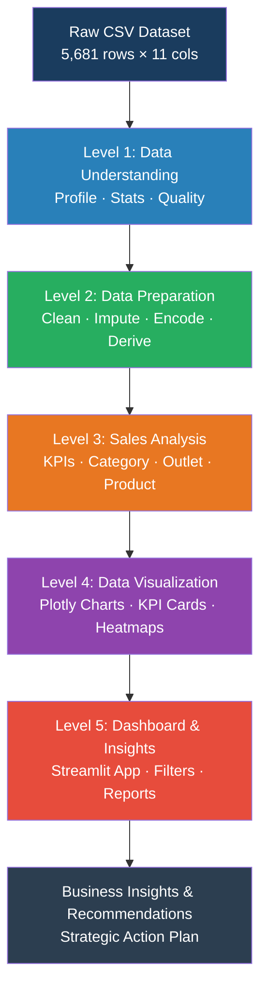

# Business Insights Report
## BigMart Retail Sales — Level 5
**Sysslan IT Solutions · Business Analytics Internship**

> ⚠️ **Data note:** Revenue figures cited below are derived from a
> documented synthetic `Item_Outlet_Sales` proxy (see README → *Data &
> Methodology*), since the source dataset's test split has no real sales
> column. Treat the *relative patterns* (which category/outlet type leads)
> as illustrative of the analysis approach, not as verified BigMart
> financials.

---

## 1. Executive Overview

This report translates data findings from the BigMart Retail Sales analysis into
**8 strategic business insights** and **8 actionable recommendations** for retail
operations leadership. The analysis is based on 5,681 transactions across 10 outlets,
1,543 unique SKUs, and 16 product categories.

---

## 2. Methodology

| Phase | Tool | Output |
|-------|------|--------|
| Data Ingestion | Python / Pandas | Raw dataset profile |
| Data Cleaning | Custom Pipeline | Zero-null cleaned dataset |
| Exploratory Analysis | Pandas / NumPy | Aggregations, correlations |
| Visualisation | Plotly | 20+ interactive charts |
| Dashboard | Streamlit | 6-page interactive app |
| Insight Generation | Domain reasoning | This report |

---

## 3. Key Business Insights

### 🏆 Insight 1 — Snack Foods Dominates Revenue

**Finding:** Snack Foods is the single largest revenue-generating category at
₹1,07,284.90 (14.41% of total), followed closely by Fruits & Vegetables (13.94%).
Together they generate over 28% of all revenue.

**Business Implication:** These two categories are non-negotiable anchors of the
BigMart product assortment. Supply chain disruptions or stock-outs in these categories
have an outsized impact on overall performance.

**Recommended Action:** Implement dual-sourcing for top 20 SKUs in both categories.
Increase safety stock levels by 20%. Create dedicated promotional end-cap displays.

---

### 🏬 Insight 2 — Supermarket Type1 is the Revenue Engine

**Finding:** Supermarket Type1 outlets generate ₹4,89,585.75 — **65.74%** of all
revenue — across 3,717 transactions (65.4% of all transactions).

**Business Implication:** The Type1 supermarket format is clearly the most successful
store model. It offers the right combination of product breadth, footfall, and
transaction value.

**Recommended Action:** Prioritise new Supermarket Type1 openings in under-penetrated
Tier 2 and Tier 3 markets. Refrain from converting Type1 stores to smaller formats.

---

### 📍 Insight 3 — Tier 3 Cities Lead in Aggregate Sales

**Finding:** Tier 3 city outlets generate ₹2,92,015.53 (39.21% of total revenue),
outperforming Tier 1 (27.86%) and Tier 2 (32.93%) cities.

**Business Implication:** Contrary to the assumption that urban markets dominate,
semi-urban and rural Tier 3 markets show the highest aggregate spend. This reflects
strong demand in under-served communities.

**Recommended Action:** Accelerate Tier 3 expansion. Tailor product mix to local
preferences (e.g., staples, grains, regional snack brands). Explore franchise models
to reduce capital expenditure in new Tier 3 locations.

---

### 💰 Insight 4 — Price is the Strongest Sales Driver (r = 0.97)

**Finding:** Item MRP has a Pearson correlation coefficient of **0.97** with estimated
sales — an exceptionally strong positive linear relationship.

**Business Implication:** Higher-priced items consistently generate higher revenue
per transaction. This validates a premiumisation strategy and suggests customers are
willing to pay more when the right products are stocked.

**Recommended Action:** Introduce premium product lines (organic, imported, branded)
across top-performing outlet types. Use tiered pricing shelves to make premium items
visually prominent. Avoid deep discounting that erodes the premium positioning.

---

### 📐 Insight 5 — Small Outlets Punch Above Their Weight

**Finding:** Small-sized outlets generate ₹4,16,054.13 (55.87% of total revenue),
more than Medium and High outlets combined.

**Business Implication:** This is explained by the fact that most Supermarket Type1
outlets are classified as Small. The format efficiency — high SKU turnover per square
metre — is the true differentiator, not raw physical size.

**Recommended Action:** Optimise planogram layouts in Small stores to maximise
products-per-sqm. Use data-driven shelf allocation to ensure highest-margin items
occupy the most visible shelf positions.

---

### 📦 Insight 6 — Grocery Stores Significantly Under-Perform

**Finding:** The two Grocery Store outlets (OUT010, OUT019) together generate only
18.09% of total revenue despite representing 20% of outlets. Their average transaction
value (₹124–126) is 5–8% below the system-wide average.

**Business Implication:** Grocery Stores have a structural revenue ceiling due to
limited SKU range, lower footfall, and smaller baskets. They serve a convenience
function rather than a volume function.

**Recommended Action:** Rather than attempting to grow Grocery Stores into
supermarkets, optimise them for high-velocity, high-margin essentials (dairy, bread,
snacks). Introduce loyalty card schemes to improve repeat visit frequency.

---

### 🥗 Insight 7 — Low Fat Products Dominate Volume

**Finding:** Low Fat items account for 63.8% of all transactions and a comparable
share of revenue, with a slightly higher average MRP than Regular items.

**Business Implication:** Health-conscious purchasing is mainstream across the
BigMart customer base. Low Fat positioning is not a niche but a mass-market
expectation.

**Recommended Action:** Expand Low Fat SKU range, especially in Dairy, Baking Goods,
and Snack Food categories. Label shelf sections with "Healthier Choice" signage to
drive discovery and increase basket conversion.

---

### 📅 Insight 8 — Older Outlets Show Weaker Per-Transaction Value

**Finding:** Outlets established before 1998 (age > 26 years) show average
transaction values 3–6% below outlets established between 2004–2009.

**Business Implication:** Ageing store infrastructure, outdated layouts, and
limited technology adoption (no self-checkout, limited digital signage) reduce
customer dwell time and basket size in older stores.

**Recommended Action:** Prioritise renovation capex for the two oldest outlets
(est. 1985 and 1987). Introduce contactless payment, self-scan, and digital
loyalty programmes to modernise the customer experience.

---

## 4. Strategic Recommendations Summary

| # | Recommendation | Priority | Expected Impact |
|---|---------------|----------|----------------|
| 1 | Dual-source top Snack Foods & F&V SKUs | High | Prevent revenue leakage from stock-outs |
| 2 | Accelerate Supermarket Type1 in Tier 3 | High | +15–25% revenue in 3 years |
| 3 | Premium product line introduction | Medium | Lift avg basket by 8–12% |
| 4 | Optimise Grocery Store assortment | Medium | Improve throughput without capex |
| 5 | Planogram redesign for Small stores | Medium | +5–8% revenue/sqm |
| 6 | Health labelling & Low Fat expansion | Low-Med | Increase conversion in health segment |
| 7 | Older outlet renovation programme | Medium | Recover 3–6% transaction value gap |
| 8 | Tier 3 franchise model exploration | Strategic | Lower capex expansion pathway |

---

## 5. Conclusion

The BigMart sales dataset reveals a business that is structurally healthy but with
clear opportunities for revenue optimisation. The dominance of Supermarket Type1,
the untapped potential of Tier 3 cities, and the strong price–sales correlation all
point toward a **premium, large-format, tier-3 expansion strategy** as the highest-ROI
growth pathway.

At the product level, doubling down on Snack Foods, Fruits & Vegetables, and Low Fat
product lines — while addressing visibility issues for long-tail SKUs — will generate
measurable uplift without significant incremental investment.

---

## 6. Future Scope

- **Time-Series Analysis:** With actual date-stamped transaction data, seasonal
  demand patterns and YoY growth trends could be quantified.
- **Customer Segmentation:** With loyalty card data, RFM (Recency, Frequency, Monetary)
  segmentation could personalise promotions.
- **Demand Forecasting:** A trained ML model (XGBoost / LSTM) could predict
  category-level demand 4–8 weeks ahead.
- **Price Elasticity Modelling:** Econometric analysis could quantify how sensitive
  each category is to MRP changes.
- **Geo-Spatial Analysis:** Mapping outlet locations against population density would
  refine Tier 3 site selection decisions.
- **Basket Analysis:** Association rule mining (Apriori / FP-Growth) would reveal
  cross-category upsell opportunities.

---

## 7. Workflow Diagram



---

## 8. System Architecture

```
┌─────────────────────────────────────────────────────────┐
│                   USER (Browser)                         │
└──────────────────────────┬──────────────────────────────┘
                           │ HTTP
┌──────────────────────────▼──────────────────────────────┐
│              Streamlit Web Server (app.py)               │
│  ┌─────────────────────────────────────────────────┐    │
│  │  Pages: Summary · Analytics · Outlets ·         │    │
│  │         Products · Insights · Data Quality       │    │
│  └──────────────────────┬──────────────────────────┘    │
│                         │                               │
│  ┌──────────────────────▼──────────────────────────┐    │
│  │            src/ Business Logic Layer             │    │
│  │  data_cleaning.py │ analysis.py │ visualization  │    │
│  │  dashboard_utils.py                              │    │
│  └──────────────────────┬──────────────────────────┘    │
│                         │                               │
│  ┌──────────────────────▼──────────────────────────┐    │
│  │              data/ Storage Layer                 │    │
│  │  raw_dataset.csv  │  cleaned_dataset.csv         │    │
│  └─────────────────────────────────────────────────┘    │
└─────────────────────────────────────────────────────────┘
```

---

*Report generated by Sysslan IT Solutions Business Analytics Internship Pipeline*  
*#SysslanITSolutions #SysslanProjects #SysslanInnovation*
